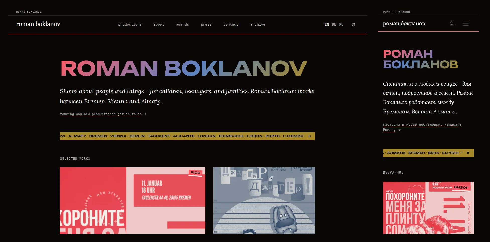
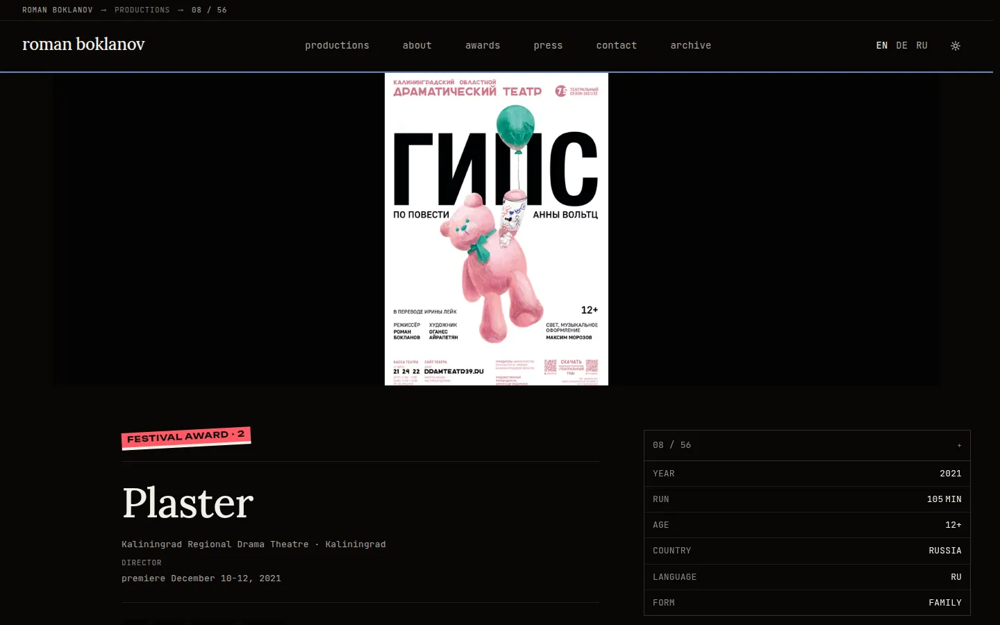

# boklanov.com

[](https://github.com/octrow/boklanov/actions/workflows/build.yml)
[](license)

[Русская версия](README.ru.md)

Source of [boklanov.com](https://boklanov.com), the portfolio of theatre director Roman Boklanov.
A festival curator opens it on a phone and has a minute and a half. He sees what Roman staged, where it toured,
which awards it won, and how to ask about bringing a show over.

Next.js 15 (App Router) and Payload CMS 3 in one process, Postgres, images on Cloudflare R2.
Three languages (EN, RU, DE), 56 productions, Lighthouse 100/100/100/100 on the production site (measured 2026-05-04).



## What's in it

- Payload admin at `/admin` for one non-technical editor, with a "needs work" list on the dashboard.
- Saving a production updates the live page in a few seconds, with no rebuild.
- Poster first on every card and production page.
- Booking button that depends on the show status, with a ready first Telegram message.
- Uploads go to R2 and get four AVIF sizes. Open Graph image per production.
- `hreflang`, sitemap with `lastmod`, RSS in RU and EN.
- Three languages, two themes (dark and light "paper").

More detail: [docs/features.md](docs/features.md).



## Run it locally

Node 22 and Docker. This starts the site on an empty database, the same way CI builds it.

```bash
git clone https://github.com/octrow/boklanov.git && cd boklanov
npm install
cp .env.example .env              # set PAYLOAD_SECRET: openssl rand -base64 48
docker compose up -d db           # Postgres 17 on localhost:5433
npm run payload -- migrate        # create the schema
npm run dev                       # http://localhost:3000, admin at /admin
```

The first visit to `/admin` asks you to create a user. Image upload needs the R2/S3 variables from `.env.example`;
the rest of the site runs without them.

```bash
npm test                          # eslint + prettier
npm run build                     # prebuild regenerates payload-types.ts and the admin import map
```

## Layout

```
app/[locale]/        pages: home, productions, about, awards, press, contact, archive
app/(payload)/admin  Payload admin
app/api/             og image, r2-asset upload, revalidate
collections/ globals/ Payload schemas (Productions, About, Contact)
components/          React components + CSS modules
lib/                 data access (Payload Local API), CDN, image variants
messages/            UI strings: en, ru, de
migrations/          Payload schema migrations
scripts/ ops/        one-off data and maintenance scripts
```

Full developer notes (env vars, content model, images, deploy, constraints): [docs/DEVELOPMENT.md](docs/DEVELOPMENT.md).
Design system: [DESIGN.md](DESIGN.md).

## License

The code is under the [MIT license](license). Photographs, posters, texts and other content belong to Roman Boklanov
and their authors and are not covered by it; please don't reuse them without permission.

The project started as a fork of [nextjs-notion-starter-kit](https://github.com/transitive-bullshit/nextjs-notion-starter-kit)
by Travis Fischer and was later rewritten on Payload.
