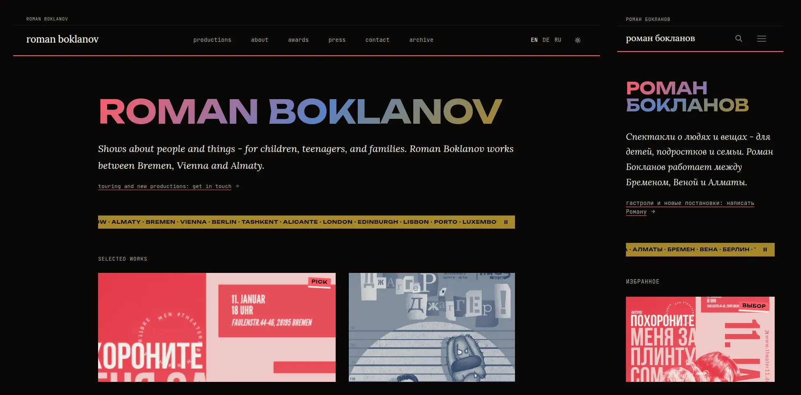
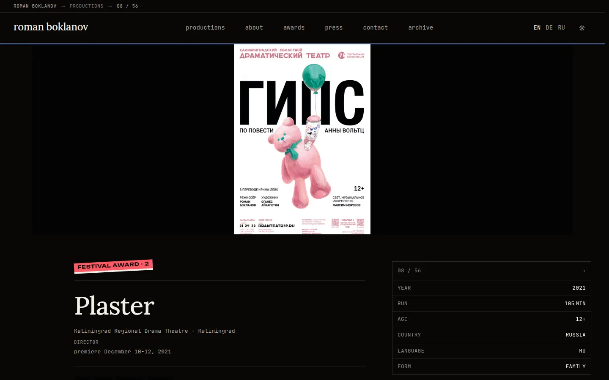

# boklanov.com

[](https://github.com/octrow/boklanov/actions/workflows/build.yml)
[-blue.svg>)](license)

[Русская версия](README.ru.md)

Source of [boklanov.com](https://boklanov.com), the portfolio of theatre director Roman Boklanov. It is written for
a festival curator or a theatre's artistic director who opens it on a phone and has a minute and a half: what he
staged, where it toured, which awards it won, and how to ask about bringing a show over.

Next.js 15 (App Router) with Payload CMS 3 running in the same process, on Postgres, with images on Cloudflare R2.
Three languages (EN, RU, DE), 56 productions, and Lighthouse 100/100/100/100 on the production site (measured
2026-05-04).



## What's in it

- **Payload admin at `/admin`**, built for one non-technical editor: Russian originals shown under the EN/DE fields,
  a "needs work" list on the dashboard (missing translation, year or poster), a status per production.
  Saving fires `revalidateTag`, so the page updates a few seconds later with no rebuild.
- **Poster first.** Every card and production page leads with the poster; photos come after.
- **Booking button that depends on status**: "ask about touring", "about a new production" or "about the premiere".
  It leads to the contact page, where the Telegram link carries a first message already written for that show.
- **Images**: uploads go through `/api/r2-asset`, which writes the source to R2 and bakes four AVIF sizes on the spot.
  Stored width and height keep the gallery from shifting; LQIP placeholders live next to each production.
- **Per-production Open Graph images** rendered with `@vercel/og`.
- **SEO**: `hreflang` alternates, sitemap with a real `lastmod` per production, an RSS feed in RU and EN.
- **Ops in CI**: a nightly encrypted database backup, a quarterly dead-link check of the live site.
- Self-hosted fonts (Lora, Inter, JetBrains Mono, Unbounded), two themes (dark by default, light "paper").



## Run it locally

Node 22 and Docker. This starts the site on an empty database, the same way CI builds it.

```bash
git clone https://github.com/octrow/boklanov.git && cd boklanov
npm install
cp .env.example .env              # set PAYLOAD_SECRET: openssl rand -base64 48
docker compose up -d db           # Postgres 17 on localhost:5433
npm run payload -- migrate        # create the schema
npm run dev                       # http://localhost:3000, admin at /admin
```

The first visit to `/admin` asks you to create a user. Image upload needs the R2/S3 variables from `.env.example`;
the rest of the site runs without them.

```bash
npm test                          # eslint + prettier
npm run build                     # prebuild regenerates payload-types.ts and the admin import map
```

## Layout

```
app/[locale]/        pages: home, productions, about, awards, press, contact, archive
app/(payload)/admin  Payload admin
app/api/             og image, r2-asset upload, revalidate
collections/ globals/ Payload schemas (Productions, About, Contact)
components/          React components + CSS modules
lib/                 data access (Payload Local API), CDN, image variants
messages/            UI strings: en, ru, de
migrations/          Payload schema migrations
scripts/ ops/        one-off data and maintenance scripts
```

Full developer notes (env vars, content model, images, deploy, constraints): [docs/DEVELOPMENT.md](docs/DEVELOPMENT.md).
Design system: [DESIGN.md](DESIGN.md).

## License

The code is under the [MIT license](license). Photographs, posters, texts and other content belong to Roman Boklanov
and their authors and are not covered by it; please don't reuse them without permission.

The project started as a fork of [nextjs-notion-starter-kit](https://github.com/transitive-bullshit/nextjs-notion-starter-kit)
by Travis Fischer and was later rewritten on Payload.
