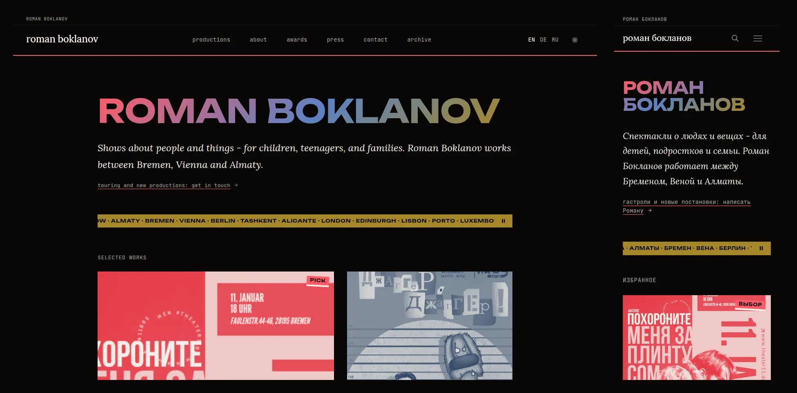
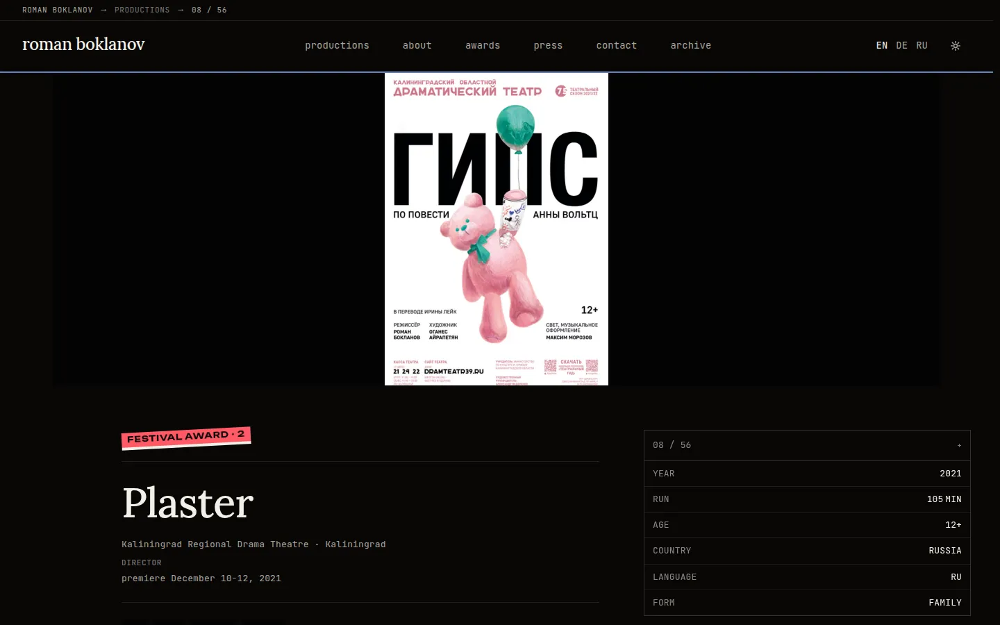

# boklanov.com

[](https://github.com/octrow/boklanov/actions/workflows/build.yml)
[](license)

[English version](README.md)

Исходники [boklanov.com](https://boklanov.com), сайта-портфолио театрального режиссёра Романа Бокланова.
Куратор фестиваля открывает его с телефона, и у него полторы минуты. Он видит, что Роман поставил, где спектакли
гастролировали, какие у них награды и как спросить о гастролях.

Next.js 15 (App Router) и Payload CMS 3 в одном процессе, Postgres, картинки на Cloudflare R2.
Три языка (EN, RU, DE), 56 спектаклей, Lighthouse 100/100/100/100 на проде (замер 2026-05-04).



## Что внутри

- Админка Payload на `/admin` для одного редактора, на главной список «Нужно доделать».
- После сохранения спектакля живая страница обновляется за несколько секунд, без пересборки.
- Афиша первой на каждой карточке и странице спектакля.
- Кнопка записи зависит от статуса спектакля, в Telegram уходит готовое первое сообщение.
- Загрузки идут в R2 и получают четыре размера AVIF. Open Graph картинка на каждый спектакль.
- `hreflang`, sitemap с `lastmod`, RSS на русском и английском.
- Три языка, две темы (тёмная и светлая «paper»).

Подробнее: [docs/features.ru.md](docs/features.ru.md).



## Запуск локально

Нужны Node 22 и Docker. Так сайт поднимается на пустой базе, так же его собирает CI.

```bash
git clone https://github.com/octrow/boklanov.git && cd boklanov
npm install
cp .env.example .env              # задай PAYLOAD_SECRET: openssl rand -base64 48
docker compose up -d db           # Postgres 17 на localhost:5433
npm run payload -- migrate        # создать схему
npm run dev                       # http://localhost:3000, админка на /admin
```

При первом заходе на `/admin` Payload попросит создать пользователя. Для загрузки картинок нужны переменные R2/S3
из `.env.example`, остальной сайт работает без них.

```bash
npm test                          # eslint + prettier
npm run build                     # prebuild перегенерирует payload-types.ts и import map админки
```

## Структура

```
app/[locale]/        страницы: главная, спектакли, о Романе, награды, пресса, контакты, архив
app/(payload)/admin  админка Payload
app/api/             og-картинки, загрузка в r2-asset, revalidate
collections/ globals/ схемы Payload (Productions, About, Contact)
components/          React-компоненты + CSS-модули
lib/                 доступ к данным (Payload Local API), CDN, варианты картинок
messages/            строки интерфейса: en, ru, de
migrations/          миграции схемы Payload
scripts/ ops/        разовые скрипты для данных и обслуживания
```

Подробные заметки для разработчика (переменные окружения, модель контента, картинки, деплой, ограничения):
[docs/DEVELOPMENT.md](docs/DEVELOPMENT.md), на английском. Дизайн-система: [DESIGN.md](DESIGN.md).

## Лицензия

Код распространяется по [лицензии MIT](license). Фотографии, афиши, тексты и прочий контент принадлежат Роману
Бокланову и их авторам и под неё не попадают; не используйте их без разрешения.

Проект начинался как форк [nextjs-notion-starter-kit](https://github.com/transitive-bullshit/nextjs-notion-starter-kit)
Трэвиса Фишера, потом был переписан на Payload.
