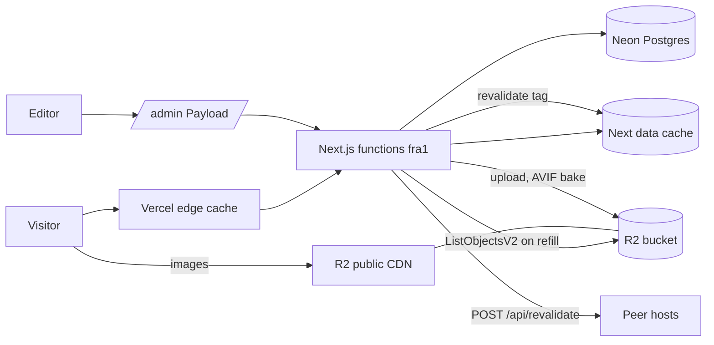

# System design review: boklanov

Portfolio site of one theatre director (boklanov.com). Next.js + Payload CMS on Vercel (fra1), Postgres on Neon, images on Cloudflare R2. Stack, flow and findings: [logic-map.md](logic-map.md). Review date 2026-11-05.

## Assumptions

| Item                         | Value                                                                          | Label                              |
| ---------------------------- | ------------------------------------------------------------------------------ | ---------------------------------- |
| Editors                      | 1 (the owner), a few saves per week                                            | assumed                            |
| Visitors                     | 300/day, 6 requests/day each (pages plus API routes, not assets), peak x5      | assumed (no analytics read)        |
| Stress case                  | 30,000 visitors/day, same shape                                                | assumed                            |
| Productions                  | ~41 (one dir each in `public/productions`)                                     | measured (`ls public/productions`) |
| Local media                  | 122 MB in `public/productions`, 341 files (227 jpg, 85 webp), 129 MB `public/` | measured (`du`, `find`)            |
| Content query                | one `payload.find`, limit 500, `locale: all`, depth 0                          | measured (`lib/content.ts:635`)    |
| Migrations                   | 15                                                                             | measured (`ls migrations`)         |
| Repo activity                | 1202 commits, 113 in last 30 days                                              | measured (`git log`)               |
| R2 bucket object count       | unknown, several thousand with 5 AVIF widths per image                         | assumed                            |
| Prod traffic, p95, Neon size | not available locally                                                          | not measured                       |

Not touched: no ssh, no Neon, no R2, no app start.

## 0. What exists (rung today)

- Kind: site (SSG/ISR, Next App Router) plus a CMS admin at `/admin` in the same deployment. Entry points table: logic-map "Entry points".
- Data: Neon Postgres via Payload Local API; media in R2 behind `NEXT_PUBLIC_CDN_BASE`; dev DB is `docker-compose.yml` Postgres 17 on :5433.
- Cache: Next data cache `unstable_cache` (keys `productions:all:v2`, `about:global`, `contact:global`), busted by tags from Payload hooks (logic-map step 10). No Redis.
- Deploy: Vercel, region `fra1` (`vercel.json`); ignore-build script skips docs-only commits (`scripts/vercel-ignore-build.sh`). Serverless bundle trimmed by `outputFileTracingExcludes` because media was ~210 MB (`next.config.js:24-32`).
- Background work: none. No queue, no cron. One-off scripts in `scripts/` run by hand.
- Ladder rung today: rung 5-equivalent by construction (CDN-served static pages plus object storage), with a single stateless function tier and managed DB. The owner operates nothing; Vercel and Neon are the "VM".

## 1. Requirements

One sentence: serve a multilingual (en/de/ru) read-mostly portfolio fast and indexable, and let one editor change content and see it live within minutes.

Functional: browse productions, view one production, archive/awards/press/contact/about, feeds (`/feed`, `/llms.txt`, sitemap, OG image), admin edit with image upload.
Out of scope: accounts, comments, bookings (CTA links to a contact page), search backend (Cmd-K index is built at render, `lib/search`).

Non-functional:

- Scale: tiny, see assumptions. Traffic spikes only from a press mention or social share.
- Latency: page TTFB from CDN edge. p95 target 300 ms (assumed).
- Availability: downtime of the admin is fine; the public site should survive a Neon outage (static HTML already built).
- Consistency: eventual. An edit may take seconds to show; stale for one cache cycle is OK.
- Durability: the DB (productions text) and R2 originals. Logic-map notes R2 is the only copy of admin uploads. Backups: see Risks.
- Security: admin session guard on upload routes; shared secret on `/api/revalidate`.
- Observability: Vercel logs only; `console.warn` in content load.

## 2. Napkin math

Normal case, assumed 300 DAU:

```
DAU 300 x 6 req/user/day
traffic
  requests/day ............................... 1.8k
  average .................................... 0.0 req/s
  peak (x5) .................................. 0.1 req/s
app tier
  servers @ 100 req/s, 70% util, +1 spare .... 2
read path
  reach the DB (99% hit) ..................... 0.0 req/s
  cache memory (80/20) ....................... 10.8MB
database
  writes at peak ............................. 0.0 req/s
  shards @ 2000 w/s .......................... 1
storage
  after 5 years .............................. 19.7MB
network
  egress at peak ............................. 124.9kbit/s
verdict: rungs 1-2: one good VPS. Ship it.
```

Stress case, assumed 30,000 DAU (100x): 180k requests/day, 2.1 req/s average, 10 req/s peak, 0.1 req/s reaching the DB, 1 DB, 2 servers by the formula. Still rungs 1-2. Command: `napkin.py --dau 30000 --req-per-user 6 --peak 5 --hit-rate 0.99 --read-share 0.999 --server-rps 100 --object-kb 30 --response-kb 150`.

Reading: request rate is irrelevant at this scale. What matters is cost per cache refill (step 6) and the static-asset path (CDN, not the function).

Refill cost per `productions` tag bust, estimated from the code, not timed: 1 SQL query (41 rows, `locale: all`), N `LIST` calls of 1000 keys each on R2 (assumed 3-8 for several thousand objects), `fs.readFileSync` of ~41 `lqip.json`. Assumed under 2 s; not measured.

## 3. API contract

n/a as a product API. The admin and public APIs are small and listed in logic-map "Entry points": `POST/DELETE /api/r2-asset` (session guard), `POST /api/revalidate` (shared secret), `GET /api/og/<slug>`, `GET /api/share-image`. No idempotency keys needed (no money objects).

## 4. High-level architecture



Why each box:

- Vercel edge plus data cache: the napkin shows 0.1 req/s; pages are static, so no origin cost per visit.
- Neon: relational content with 3 locales per field, one editor, tiny size. Managed, no ops.
- R2 and its CDN: 129 MB of local media alone; keeps images out of the function bundle (`next.config.js:24`) and off egress fees.
- Peer fan-out: dev and preview hosts share one Neon DB, so a save must bust caches elsewhere (`hooks/revalidate-peers.ts`). Only needed while that setup exists.
- No Redis, no queue: nothing is on a request path that waits on a slow third party except the OG poster fetch and R2 list on refill.

## 5. Data

Engine: Postgres (Neon), correct for relational CMS data. 15 migrations in `migrations/`. Payload owns the schema; the core read is one full-table fetch (`productions`, limit 500) so no index is needed beyond the primary key and slug uniqueness. The limit of 500 is 12x the current ~41 rows.

Cache pattern: read-through via `unstable_cache`, tag invalidation on write (logic-map steps 3, 10). Cached: whole `Production[]` for all locales, About, Contact. TTL: none; invalidated only by tags. If the cache is empty or lost (deploy): next request refills from Neon plus R2 list. If Neon is down at refill: step 3 throws; `generateStaticParams` catches and returns `[]` (logic-map step 3), so pages render on demand and 500 until Neon returns.

Staleness trap: the `productions` tag is one coarse key; any save rebuilds everything (fine at 41 rows).

## 6. Scale and failure

x10 and x100 traffic: nothing saturates by the napkin. At 100x (10 req/s peak) the CDN absorbs it; the function tier sees only misses. First real limit is not traffic but the function bundle size (media crept to ~210 MB against Vercel's 250 MB cap, per `next.config.js:24-32`) and Neon connection count on cold-start bursts (assumed, not measured; Payload opens its own pool per function instance).

Failure table:

| Event                                | Effect                                                   | Handling today                                                                        |
| ------------------------------------ | -------------------------------------------------------- | ------------------------------------------------------------------------------------- |
| Neon down                            | Admin down. Built pages keep serving. Cache refill fails | step 3 throws, static params fall back to `[]`                                        |
| R2 list fails                        | Images unchecked, everything kept                        | warn and continue (`lib/content.ts:552`)                                              |
| R2 down                              | Images 404, pages render with broken images              | no fallback, the CDN is the single source                                             |
| Slow CDN during poster probe (hooks) | Save slower, dims null                                   | probe errors never block save (logic-map step 9); no explicit timeout seen in the doc |
| Peer host slow                       | Save delayed at most 3 s per peer                        | `PEER_TIMEOUT_MS = 3000` (`hooks/revalidate-peers.ts:30`)                             |
| Vercel region fra1 down              | Whole site down                                          | single region by choice                                                               |
| Bad deploy                           | Rollback via Vercel UI                                   | `ignoreCommand` only skips docs-only builds, so every code push builds                |

Retries: none anywhere in the read path or hooks. Rate limits: none on `/api/og/*` (CPU-heavy satori render, cached by URL at the edge but arbitrary `slug` and `locale` combinations are bounded by 41 x 3). Backups: R2 backup scripts were removed 2026-11-05 (`docs/r2-operations.md` is the reference); a Neon PITR restore has not been rehearsed (not verified).

## 7. Trade-offs

- Eventual consistency for speed: edits show after tag bust, not instantly, no per-slug tag; chosen because 41 rows rebuild in about a second.
- Monolith: site and CMS in one Next.js app. Saves a deployment, costs a bigger function bundle and admin code in the same tree as the public site.
- Managed everything over a VM: zero ops, cost is vendor coupling (Vercel, Neon, R2) and no query to the box when something is odd.
- Locale fallbacks in code (`??` chains) over translated-or-404: indexable untranslated pages and an SEO cost (logic-map "Known gaps" #7).
- Cache by coarse tag: simplicity over granularity; fine until hundreds of productions.
- Shared Neon across dev, preview, prod (guarded by `ALLOW_PROD_DB`, `payload.config.ts`): cheap and realistic data, cost is that a mistaken dev write hits prod and needs the peer fan-out.

## 8. Summary

Design: static pages on Vercel's CDN, Payload on Neon for content, R2 for images, tag-based cache busts. At 0.1 req/s peak (assumed) and 1 editor it is far above what it needs.
Would change if wrong: if the real traffic is above ~1k req/s (needs a press spike), nothing but the OG route and R2 egress matter; if the content grows past 500 productions the `limit: 500` truncates (a warning is logged).
Next rung and trigger: none needed for traffic. Move image handling to a bundle-size budget check when `public/` grows past ~150 MB or the function nears 250 MB; split the `productions` cache tag per slug when a refill takes over 5 s (needs a timing log first).

## Risks

- MEDIUM, `lib/content.ts`: `limit: 500` (`PRODUCTIONS_LIMIT`) still truncates past 500 productions (41 today), but a console warning now fires when the cap is hit (✅ 2026-11-05); no pagination.
- MEDIUM, `next.config.js:24-32`: bundle size is held under 250 MB only by an exclude glob over a dynamic `fs` path; a new media extension (e.g. `.heic`, `.mp3`) in `public/productions` would re-bloat every function and fail the deploy.
- MEDIUM, `docs/r2-operations.md`: R2 is the only copy of admin uploads and the backup scripts were removed 2026-11-05 (logic-map "Image bake and R2 mirror scripts"); no verified restore. Data-loss risk if the bucket or key is lost.
- MEDIUM, `lib/content.ts:552-575`: unbounded `ListObjectsV2` loop on every cache refill; cost grows with bucket size (x5 widths per image) and runs inside the first request after a bust. Assumed several seconds at a large bucket; key count and duration are now logged per listing (✅ 2026-11-05), no page cap.
- LOW, `hooks/revalidate-peers.ts:30`: up to 3 s per peer added to a save; peers sequential or parallel was not checked.
- LOW, `app/api/og/[slug]/route.tsx`: public CPU-heavy render with a remote poster fetch and no explicit rate limit; bounded by 41 slugs x 3 locales (assumed edge-cached).
- LOW, `proxy.ts`: no retry or circuit breaker toward Neon or R2 on any path; relies on cache to hide outages.
- LOW, `temp.log` (35 KB, repo root) is an unrelated backend log from another project; not a scaling risk but should not be in the repo (confirm it is tracked).
- Logic-map "Known gaps" #7 (untranslated pages indexable) is an SEO issue, not a scaling one, so it is not repeated here.
